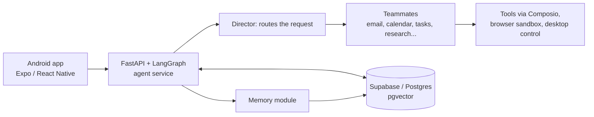

# Tubelight

**AI teammates you talk to like people.** A native Android app and a Python agent service. Each teammate has a role, a face, its own chats and tools, and they all share one memory of your world.

> **Status: in active development.** I use Tubelight every day, but it is not finished and not publicly launched. This README says what works, where the rough edges are, and which numbers come from my own evaluations, with their limits next to them.

## What it does

- **Teammates and group chats.** Direct chats (several per teammate) and project groups. In a group, one director call decides who is being addressed, who speaks and in what order.
- **They act, with approval where it matters.** 1,500+ apps through Composio (Gmail, Calendar, GitHub, Linear, Slack…), web search, and documents (PDF, Word, Excel, PowerPoint). They can use your phone (alarms, calls, texts, apps through accessibility) and your own computers (a paired runner: files, sandboxed commands, desktop apps). Anything risky waits for Approve / Reject, in the chat or from the notification.
- **Follow-ups and automations.** "Circle back at 4", standing instructions on a schedule or an app event, nudges, and silent checks.
- **Voice.** Real-time voice mode (Gemini Live), an assistant on the side button, and an optional call stand-in that answers calls for you.
- **Your files and day.** A Vault with native viewers (PDF, Office, images, video), and Orbit: to-dos, a calendar built from the phone's own calendars, alarms and reminders.
- **Memory you can see and talk to.** See below.

Built on free LLM tiers only: Gemini Flash-Lite by default, with Groq, Cloudflare Workers AI and OpenRouter as fallbacks, per-teammate model choice and a usage screen.



## Memory

One memory of your world, shared by every teammate, voice and the phone. The full design, with citations, is in [`docs/memory-v3.html`](docs/memory-v3.html).

- **Episodes → entities → facts → profiles.** What was said is kept word for word. Each fact quotes the words it came from (the server checks the quote), says how far to trust its source (you over teammates over emails and apps), and has two timelines: when it was true and when it was learned. Changed facts are closed and wrong ones retracted, never silently overwritten.
- **A salience gate decides what is worth keeping.** A fitted logistic gate turns the extractor's importance and durability ratings, novelty, trust and repetition into the chance you will need a fact later: keep, hold tentatively, or skip.
- **Recall by association.** Facts strengthen with use and fade with time (ACT-R). Entities are linked by how often they appear together (PPMI), and recall spreads activation from what a moment names (Personalized PageRank).
- **Talk to it.** The Memory teammate says what it learned and why it believes something, and lets you confirm, correct, forget or merge. It asks at most two questions per conversation.
- **Private by construction.** A teammate speaking to a caller only gets facts about that caller, never sensitive ones. This is enforced in the query, not the prompt.

### Benchmark: LoCoMo, head to head

LoCoMo, run the way Mem0's paper ran it: their answer and judge prompts, one memory per speaker, adversarial questions left out, 1,540 questions, `gpt-4.1-mini` answering and judging. I ran Mem0 OSS (2.2.1) and Graphiti (0.31.2) through the same harness.

| System | Overall | Single-hop | Multi-hop | Temporal | Open-domain |
|---|---|---|---|---|---|
| Mem0 open-source | **82.6%** | 87.0% | 73.4% | 87.2% | 55.2% |
| **Tubelight** | 78.4% | 79.8% | **75.9%** | 80.1% | **68.8%** |
| Graphiti | 68.6% | n/a | n/a | n/a | n/a |

Tubelight started at 60.2%. Reading its failures led to fixes built on conversations 0–4 only; conversations 5–9 were checked once and never studied (dev 61.3% → 78.6%, test 59.1% → 78.3%), so the gain is not fitted to the questions.

**What I claim:** under Mem0's protocol, Tubelight is about 10 points ahead of Graphiti and about 3.5 behind Mem0 OSS, and it leads both on multi-hop and open-domain questions.

**What I do not claim:** "better than Mem0" or "state of the art".

**Limits:**

- One benchmark, one run per system, run by me. Overall scores come with 95% intervals in the paper.
- The extraction prompt was tuned on Gemini Flash-Lite. With `gpt-4.1-mini` building Tubelight's memory, it scores 70.5%, and 74.9% when given Mem0's amount of context, so Mem0 still leads at equal context.
- Graphiti ran with its default local ranking, not Zep's server-side reranker.
- **Synthetic numbers overstate real performance.** The gate's high scores come from held-out synthetic data. On my real chat history the deployed extractor kept only 38% of important moments (13 positives) and the gate's calibration error was 0.24, well above the 0.1 target. The paper reports this plainly.

The LoCoMo harness for Tubelight is in [`agent-service/evals/locomo.py`](agent-service/evals/locomo.py). The scripts for the Mem0 and Graphiti runs are not in this repo yet.

## How it fits together

```
app/             Expo SDK 57 app (Expo Router, Reanimated, Skia), with its own design system in src/ui
agent-service/   FastAPI + LangGraph: teammates, tools, memory, voice, phone and computer bridges
  app/             graph.py (router, teammates, approval gate), mem.py + memgraph.py (memory), runs.py, events.py, llm.py ...
  runner/          the paired-computer runner
  sandbox/         Docker image for teammate code sandboxes
  browser/         Docker image for the server browser
  deploy/          home-server setup and run scripts
  evals/           memory, gate, LoCoMo, routing, automations, browser and computer-use evaluations
  tests/           pytest suite (fake LLM, fake database, no network)
supabase/        Postgres schema (migrations), auth, realtime
docs/            CONTRACT.md (API and realtime), DESIGN.md (design rules), memory-v3.html (memory paper)
render.yaml      Render blueprint for a hosted agent service
```

The app talks to Supabase for auth, data and realtime, and to the agent service for runs, tools and memory. The service keeps LangGraph checkpoints, its store and its memory tables in a `langgraph` schema of the same Postgres (with pgvector).

### How I run it

My instance runs on a home server (Ubuntu 24.04, Docker) behind a Cloudflare Tunnel. Teammate code sandboxes are locked down:

- The agent reaches Docker only through a socket proxy that allows containers and exec, and nothing else.
- Sandboxes (1 CPU, 1 GB, a process limit, a 10-minute wall timeout) sit on an internal network whose only way out is a Squid egress proxy that refuses private and local addresses, so a sandbox cannot reach the router, LAN devices or the server itself.
- `git push` inside the sandbox is blocked. Pushing is a separate tool that needs approval.

See [`agent-service/deploy/`](agent-service/deploy/). On hosted containers there is no Docker daemon, so the code sandbox switches itself off and the service otherwise runs unchanged.

## Run it locally

Service (details in [`agent-service/README.md`](agent-service/README.md)):

```bash
cd agent-service
uv venv .venv && uv pip install -p .venv -r requirements.txt
cp .env.example .env          # Supabase keys and at least one model key
.venv/bin/uvicorn app.main:app --port 8787
curl localhost:8787/health
```

Anything optional degrades instead of failing: without `SUPABASE_DB_URL` memory is in-process, without a Composio key there are no app connectors, and without Docker there is no code sandbox.

App (details in [`app/README.md`](app/README.md)):

```bash
cd app
npm install
npx expo run:android          # a development build; then `npx expo start --dev-client`
```

Point the app at the service with `EXPO_PUBLIC_AGENT_URL` in `app/.env`.

## Tests and evaluations

```bash
cd agent-service && .venv/bin/pytest -q     # fake LLM + fake DB, no network
cd app && npx tsc --noEmit && npx expo lint
```

Memory tests and evaluations need a scratch Postgres with pgvector:

```bash
docker run -d --rm --name tl-memtest -p 127.0.0.1:54329:5432 -e POSTGRES_PASSWORD=t pgvector/pgvector:pg17
docker exec tl-memtest psql -U postgres -c 'create extension vector'
export TL_TEST_PG=postgresql://postgres:t@127.0.0.1:54329/postgres
.venv/bin/python -m evals.memory v2           # question answering over dated chats, calls and emails
.venv/bin/python -m evals.gate run test       # what memory keeps vs what it should
BENCH_KEY=GEMINI_BENCH_API_KEY .venv/bin/python -m evals.locomo ingest   # then: answer, report
```

The other evaluations call real models, so they are not part of `pytest`.

## Roadmap

1. Close the gap to Mem0 on simple recall and dates, adopting only what measurably helps.
2. Publish the Mem0 and Graphiti comparison scripts and raw results so anyone can rerun them.
3. Run LongMemEval as a fair random sample.
4. Improve the gate on real history, where it is not yet calibrated.
5. A connector that gives other assistants and coding agents the same memory.

## Secrets

Keys live only in `agent-service/.env`, `app/.env` and `.env.test`, all gitignored. `agent-service/.env.example` lists every setting with placeholders.

## About

Built by [Venavenka Jayanth](https://github.com/Jayanth4109) at [Stepwise Studio](https://ui.stepwise.studio), an indie studio making open-source tools for design engineers. Issues and honest criticism are welcome.

## License

MIT. See [`LICENSE`](LICENSE).
